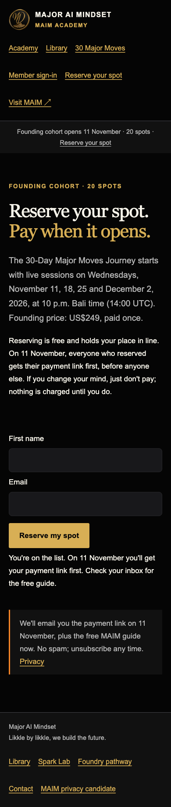
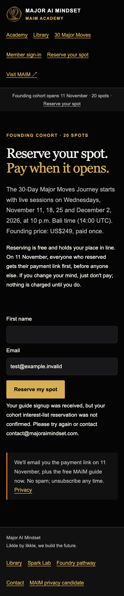
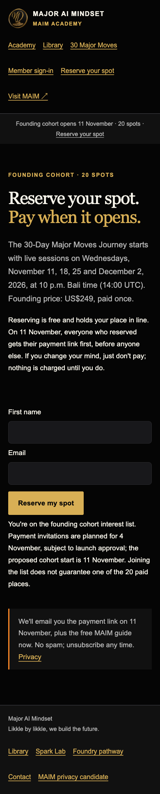
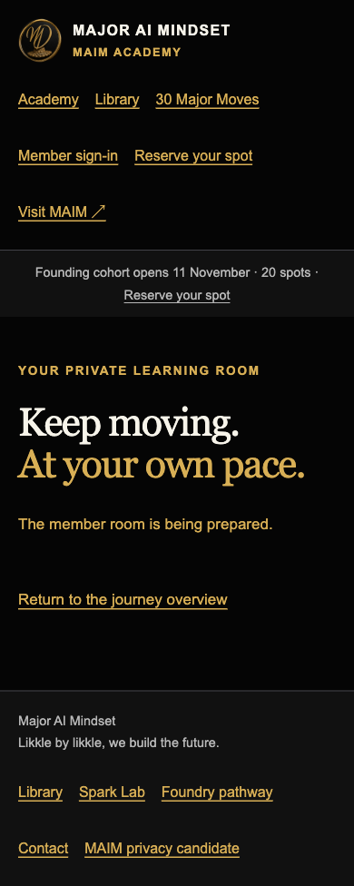

# Academy membership, commerce and operations readiness

25 October 2026, Asia/Makassar. **HOLD: hosted member/payment readiness not established.** Complete coverage report includes blocked journeys; it is not a completed end-to-end purchase certification.

**Latest decision supersedes the original report's schedule/account blockers:**
Payments open November 11 after release approval; official cohort starts November 18.
November 4 is removed. Two adult QA accounts are now explicitly authorized in private;
their addresses are not published here. Identity/schema/runtime configuration remains
blocked. See [launch revision](LAUNCH_SCHEDULE_DECISION_2026-10-25.md) and
[revised unsent invitation](PAYMENT_INVITATION_2026-11-11_DRAFT.md).
Earlier mocked screenshots/observations below preserve pre-revision evidence,
not current schedule authority. Public copy/teaser changes are Claude Code's lane.

After the owner supplied authorization, the private adult-QA allowlist and five
deliberate **false** flags were configured on Preview branch
`codex/academy-ops-readiness-2026-10-25` only: ENABLE_ACADEMY_MEMBERS,
ENABLE_ACADEMY_AUTH_EMAIL, ENABLE_ACADEMY_TEST_CHECKOUT, ACADEMY_OFFER_APPROVED,
ENABLE_ACADEMY_ADVISORY. No production scope or auth/database/Stripe secret was
added, no email was sent, and no user enrolled. Runtime tests remain blocked by
the scoped identity/schema/credential prerequisites. This scoped metadata setup
supersedes the initial zero-env observation only for the new QA branch.

## Exact source/provider snapshot

- Academy main/audited base: `69694d0219a65e2f9cb1162fac02d6b4bfede797`. Production `academy.majoraimindset.com` maps to READY deployment `dpl_8AMVFWGLMnvDNjaUsVRnZhT4qisg`, same SHA, maimacademy project. PR #7 is merged, not an open implementation branch.
- Main-site subscribe source inspected from GitHub main; observed main SHA `4360cb6a73e6f1a670c496460161d33bc3f5024e` during trace. Main can advance independently; revalidate the final release SHA.
- Read Academy canonical binding, environment/implementation/pilot/database/offer/cohort/booking docs and October 24/25 handovers. Preserve approved US$249 one-time cohort policies and the separate US$250 Blueprint offer. No published legal version edited here.
- Vercel metadata read with decryption disabled: maimacademy returned **zero environment variables**. No configuration, production flags or secrets were changed.

## 1. Reservation → provider trace

1. Academy public/reserve.js sends email/name, honeypot website, cohort=true and source=academy-reserve to main-site POST /api/subscribe.
2. The main-site handler allows exact Academy origin plus same-host callers; preflight supports POST/OPTIONS. Preview origins are not allowed by this production CORS rule. A safe protected integration test must use a dedicated preview handler/origin policy rather than widening production CORS.
3. Honeypot exits immediately with HTTP 200 before provider writes. It is not persistence or delivery evidence.
4. Real signup normalizes email, adds it to Resend's general guide segment, then attempts cohort membership. Missing/failed cohort segment yields HTTP 200 with waitlisted=false. Status 409 is treated as success for a contact; confirm actual existing-contact segment assignment in the real TEST-account journey.
5. Original Academy client ignored waitlisted and falsely announced cohort-list success for any 2xx response. Playwright reproduced this using an intercepted response with **no actual provider POST**. Branch fix requires waitlisted===true, retains retry on failures, states Nov 4 invitation as planned and distinguishes interest from paid capacity.
6. Handler has **no Airtable write** and does **not itself send the guide email**. It also drops source and does not create an explicit durable consent timestamp/event ledger. Resend contact storage is not evidence of guide-delivery automation or consent provenance.

Direct account inspection: Resend has Founding Cohort Waitlist and Start Here (5 AI Moves) segments. No Resend webhooks were returned. The existing AMA MOB OS V2 Airtable base returned no automations. Therefore no source or returned automation proves a reservation → Airtable bridge. No real reservation was submitted in this audit; receipt by Airtable remains **UNVERIFIED, with no implemented bridge found**, not a fabricated passing event.

## 2. Existing Airtable schemas — verified read-only

**MAIM Orders:** 21 fields. Primary Stripe Session ID; Email (email), Name, Contact Record ID, Stripe Customer ID, Stripe Payment Intent ID, Stripe Event ID, Offer, Payment Status, Amount Minor Units (number), Currency, Paid At, Livemode, Fulfillment Status, Receipt Email Status, Refunded At, Entitlement Status, SKU, Receipt Email Updated At, Terms URL (url), Agreement Version. Other listed fields are singleLineText. It is explicitly a Stripe-confirmed Blueprint-order table. Free interest-list entries must not masquerade as paid orders.

**MAIM Follow-up Queue:** 11 fields. Enrollment ID primary; Email (email), Name, Consent At, Source, Stage (number), Next Send At, Status, Last Sent At, Unsubscribe Token, Last Error. Other fields are singleLineText. Description limits it to explicitly opted-in assessment follow-up and Blueprint-purchase suppression. An Enrollment ID/token field does not implement cohort enrollment or unsubscribe handling. Do not repurpose its customer/offer semantics or trigger unrelated campaigns.

Correction recorded 27 October 2026: Airtable table
`tbl1pPhCa6bx3ST3E` is **MAIM Follow-up Queue**, not Contacts. A bounded search
found no Academy configuration containing that ID. Generic environment names
such as `AIRTABLE_CONTACTS_TABLE_ID` do not override the authoritative mapping
and must never be assigned this table ID. The machine-readable, credential-free
record is `data/integration-authority.json`; Academy runtime access remains off.

Integration proposal (not applied): choose a cohort-scoped durable reservation/consent ledger in canonical MAIM storage; record unique reservation event, source, consent/version/time, provider membership outcome and retry/error state. Design the intentional Airtable projection and idempotency without mixing Blueprint orders or assessment follow-ups. Never export subscriber PII to public Git.

## 3. Supabase member engine and permissions

Owner-selected target is **MAIM Ecosystem**, project `njpdlomvyalxrkluaige`, verified ACTIVE_HEALTHY through MAIM ECOSYSTEM connection. STB and ACADEMY connection returns no projects and is not the selected target. No development branches were returned.

Observed applied migrations: maim_workspace_foundation (20261014043844), maim_payments_foundation (20261014043909), maim_canonical_application_registry (20261020030402), maim_asset_catalogue (20261021123131), maim_catalogue_api (20261021123147). No Academy member/auth migration appeared.

Catalog query confirms maim/maim_ops tables, all returned tables RLS-enabled; **no academy_grants/progress/lessons/auth/booking tables** were found. Public schema table list is empty, not proof the project is empty. Existing customers.auth_user_id and memberships.user_id are UUIDs; current Academy draft references Better Auth text IDs and an unqualified "user" table. Runtime binding explicitly says not_switched/schema requires review. Do not apply that SQL unchanged to the shared project.

Existing maim customer/order/entitlement/membership SELECT policies scope to auth.uid(). Advisor reports four RLS-enabled/no-policy tables (refunds, vault_assets, webhook_events, application_registry). That is deny-by-default for roles subject to RLS, not automatically a data leak; restricted server grants and runtime access still need validation. [Supabase remediation reference](https://supabase.com/docs/guides/database/database-linter?lint=0008_rls_enabled_no_policy).

Academy draft revokes PUBLIC privileges but does not enable RLS/create row policies; all reads/writes rely on the private server's user-scoped queries. No separate runtime role/search_path/grants or full Better Auth schema is applied/verified. Hosted two-account isolation cannot pass on this foundation. Reconcile a single Supabase UUID identity or an explicit reviewed mapping in an isolated Academy schema; generate version-matched auth migrations only after that decision. Take a private backup and review rollback before shared-project DDL. No migrations, roles or test users were created here.

Auth code uses Better Auth, email/password disabled, five-minute hashed magic links, database-backed rate limits, verified sessions and private no-store responses. Recipient allowlist checked in the email adapter. Expiry/reuse, cookies, CSRF and foreign-user API access are **code-reviewed, not hosted-tested**. No two authorized account addresses or protected runtime credentials were supplied/found; account request remains pending. Progress query is server-user scoped and reflection-bounded, but no hosted persistence/export/deletion test exists.

## 4. Stripe, seats, entitlements and booking

The Academy endpoint is /api/academy-checkout (not legacy static /api/checkout). It accepts TEST keys only, requires verified session and server-selected price/amount, and adds user/offer/agreement metadata. Main-site Stripe variables do not configure this engine. No Academy TEST credential, approved terms/version or endpoint configuration exists in returned environment metadata.

Webhook code verifies raw-body signatures, rejects live events, retrieves session details, validates price/amount/currency/identity/agreement, serializes per payment intent, deduplicates event/source-payment IDs, and records refund/dispute holds before later payment events. Partial refunds conservatively hold access; full/partial policy and restoration require review. Transaction retries return 503. These paths have not run against Stripe/hosted Postgres in this audit.

Critical gaps:

- No atomic 20-seat cohort table/checkout reservation/expiry/oversell workflow. Concurrent payments can exceed 20; sequential repeat sessions can exist before any grant is created. No Checkout Session creation idempotency key.
- No fixed-cohort membership/replay authorization; group eligibility still expires 30 days after purchase, so a Nov 4 purchase could lose access before Dec 2's session.
- Booking checks owned credit/approved brief, row locks, unique constraints, 45-minute length and non-overlap. It lacks the approved 48-hour brief lead, initial seven-day refund-window exclusion, 24-hour rescheduling/courtesy/provider-extension enforcement, cancellation/no-show/completion workflow and real calendar delivery.
- Credit issuance is an insert-only active-grant trigger; reactivating a previously held grant may not issue a credit. Held/refunded grants do not imply safe seat/credit restoration.
- No private replay host/access controls, actual organizer recording entitlement or consent/decline evidence tested.
- Current local development server deliberately returns stub API responses; it is not a member-integration environment.

## 5. Playwright journey report

Browser: Chromium via Playwright CLI. Synthetic test@example.invalid is used only behind intercepted requests; no contact, email, appointment, payment or subscriber record created.

| Journey | Evidence/result | Gate |
| --- | --- | --- |
| Public reserve/sign-in/member-room/major-moves | Real production GET/render, 390px, no overflow in four sampled pages | PASS for rendering only |
| Production member/auth availability | /api/member 503; advisory 503; checkout GET 405 unavailable; webhook GET 405; static checkout GET 200 available=false | PASS fail-closed; not functional access |
| Reservation partial success | Production JS + intercepted waitlisted=false falsely reports list membership | FAIL in deployed base; fixed in review branch |
| Fixed partial success | Local branch, intercepted 200 waitlisted=false: explicit not confirmed, retry enabled | PASS mocked UI |
| Fixed confirmed interest | Local branch, intercepted waitlisted=true: interest-list success, planned Nov 4 / proposed Nov 11, no paid-seat guarantee | PASS mocked UI |
| Provider failure | Local branch, intercepted 502: support/error and retry enabled | PASS mocked UI |
| Local reserve/sign-in/member shell layout | 390/1440px, all six document widths equal viewport; axe WCAG2A/AA +2.1AA zero violations on three pages | PASS sampled; no real-device/screen-reader certification |
| A/B magic-link login, expiry, replay, sign-out, access forgery | No account allowlist/runtime environment | BLOCKED |
| A/B progress/brief/export isolation, persistence/restart, DB RLS/runtime-role validation | Identity/schema/runtime credentials unresolved | BLOCKED |
| Real app-created Stripe TEST purchase/webhook replay/refunds | No configured TEST environment and terms readiness | BLOCKED |
| 20-seat race, expiry, oversell recovery | No implemented seat-cap contract | FAIL design gate / BLOCKED runtime |
| Brief approval/booking race, refund/cancellation recovery, replay access | Draft/local constraint tests only, missing policy implementation | BLOCKED hosted |
| Resend cohort receipt, guide inbox, Airtable event | No approved real test recipient execution; no bridge found | BLOCKED/UNVERIFIED |

Screenshots (synthetic or public-only, no session/credentials):

Screenshots document UI behavior, not real payment/provider persistence. Full raw browser profiles/traces were kept out of Git. Local first build needed data paths included in sparse checkout; after correction build and lint pass. New tests: 30 assertions/subtests passing total including embedded PostgreSQL constraints and three reservation regressions. PGlite uses minimal Alice/Bob fixtures; those are **not authorized hosted accounts** or real concurrent connections. A moderate development-only fast-uri advisory was found; lock updated 3.1.8→3.1.9 and npm audit now reports zero vulnerabilities.

## 6. Legal/privacy and November campaign

Main /terms is still Blueprint Service Terms, and /privacy still explicitly says approval candidate/PENDING APPROVAL. Earlier business-policy/branding approval does not prove an Academy-specific accepted agreement or final recording/privacy notice. Academy seven-day refund/cohort/session/replay terms are distinct from Blueprint preparation/refund terms. Verify exact Academy terms/version, current publishable controller/address/contact, organizer account, captured media, retention/access/deletion/training/reuse, participant consent/decline and mailing consent before recommending activation. No final claims were invented.

Invitation draft was revised to [November 11](PAYMENT_INVITATION_2026-11-11_DRAFT.md), **not sent or scheduled**. The official start is November 18. Public copy still presenting November 11 as the start requires review and deployment through the public-site owner. Do not create an unbound Payment Link that bypasses identity/capacity/entitlement metadata.

## 7. Exact environment names — values never included

Academy private Preview runtime:

`ENABLE_ACADEMY_MEMBERS`, `ACADEMY_DATABASE_URL`, `ACADEMY_AUTH_SECRET`, `ACADEMY_ORIGIN`, `ACADEMY_PILOT_EMAILS`, `ENABLE_ACADEMY_AUTH_EMAIL`, `ACADEMY_RESEND_KEY`, `ACADEMY_EMAIL_FROM`, `ENABLE_ACADEMY_ADVISORY`.

Academy TEST payment/offer:

`ENABLE_ACADEMY_TEST_CHECKOUT`, `ACADEMY_OFFER_APPROVED`, `ACADEMY_STRIPE_KEY`, `ACADEMY_STRIPE_WEBHOOK_SECRET`, `ACADEMY_JOURNEY_PRICE_ID`, `ACADEMY_PRICE_CENTS`, `ACADEMY_TERMS_URL`, `ACADEMY_AGREEMENT_VERSION`.

Existing main-site subscribe:

`RESEND_API_KEY`, `RESEND_SEGMENT_ID`, `RESEND_COHORT_SEGMENT_ID`.

Existing Blueprint Airtable integration (does not configure Academy reservation persistence):

`AIRTABLE_PAT`, `AIRTABLE_BASE_ID`, `AIRTABLE_ORDERS_TABLE_ID`, `AIRTABLE_CONTACTS_TABLE_ID`. No existing cohort reservation or Follow-up Queue env binding was found in the subscribe handler. Do not invent variable names and claim they are implemented. Scoped runtime DB URL must use approved schema/role/search_path with verified TLS; no broad shared secret in browser code.

## 8. Prioritized GO/HOLD gates and continuation

1. **P0 identity/runtime:** reconcile UUID ownership and scoped Academy schema/auth migration; restricted runtime role; protected Preview with two specifically authorized adult test emails and verified sender. Never use unrelated client credentials.
2. **P0 capacity/payment:** atomic 20-seat admission, reservation expiration, checkout idempotency, oversell/refund recovery; complete real TEST signed-webhook replay/refund/outage matrix.
3. **P0 legal/delivery:** exact Academy legal/privacy approval and protected lessons/replays/recording, provider delivery + inbox + entitlement/support recovery.
4. **P1 reservation:** review/merge truthful waitlisted handling; implement consent/event ledger and intentional Airtable projection; verify existing-contact behavior and guide-email automation with authorized accounts.
5. **P1 service policy:** fixed cohort through Dec 2; 48h preparation/24h changes/seven-day booking boundary/courtesy/extensions; real booking concurrency and restoration.
6. **P1 campaign:** Nov 4 target versus public Nov 11 payment claim, approved app-bound enrollment URL, segment consent/suppression and internal test inbox review. Draft only until explicit send GO.

Current verdict: public rendering and fail-closed checks PASS; memberships, commerce, full reservation-delivery proof and payment invitation **HOLD**. Required owner/account step: identify two authorized adult test addresses (no passwords in chat), provide/review restricted Preview credentials through provider settings, and approve the identity/schema migration plan. No provider mutation or bulk/live send was performed. Hosted journey testing continues only once these concrete prerequisites are satisfied.
